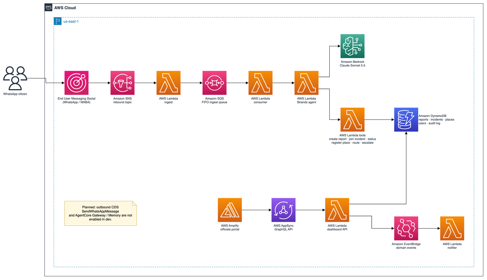

# agentic-ai-platform — urbanbot infrastructure

Infrastructure as Code (Terraform) for **urbanbot**, a WhatsApp citizen bot for
urban infrastructure reporting. Built for the AWS CDS Agentic AI Hackathon.

## For hackathon judges

UrbanBot helps residents report potholes, leaks, lighting failures, and waste in
the WhatsApp channel they already use, while municipal staff work the resulting
incident clusters in a role-aware portal. It focuses on shared incidents rather
than isolated tickets, so each additional nearby report can improve visibility
and prioritization.

### Architecture



The diagram source is editable in [draw.io](docs/architecture/urbanbot-architecture.drawio).
Inbound WhatsApp events flow through AWS End User Messaging Social, SNS, ingest
Lambda and an SQS FIFO queue to a consumer and the Strands agent Lambda. The
agent uses Amazon Bedrock Claude Sonnet 5.5 and six scoped Lambda tools; those
tools operate on DynamoDB. The staff portal is hosted by Amplify and reaches its
backend through AppSync. Status changes emit EventBridge events to the notifier.

| AWS service | Role in this repository |
| --- | --- |
| End User Messaging Social, SNS, SQS | WhatsApp inbound events, fan-out and FIFO work queue |
| Lambda, Amazon Bedrock, Guardrails | Ingest, consumer, agent, tools and constrained model calls |
| DynamoDB | Reports, incidents, users, places and audit data |
| AppSync, Cognito, Amplify, Amazon Location | Authenticated officials portal, GraphQL API, hosting and map |
| EventBridge | Domain events to the notification workflow |

### CDS runtime call status

The inbound integration is implemented in
[`modules/compute/src/ingest/handler.py:135`](modules/compute/src/ingest/handler.py#L135)
and invokes the queue at
[`modules/compute/src/ingest/handler.py:342`](modules/compute/src/ingest/handler.py#L342).
The agent creates its Bedrock model at
[`modules/agent/src/agent/handler.py:401`](modules/agent/src/agent/handler.py#L401)
and runs it at
[`modules/agent/src/agent/handler.py:424`](modules/agent/src/agent/handler.py#L424).

There is currently **no runtime import or call** to the CDS End User Messaging
Social `SendWhatsAppMessage` client. The notifier’s outbound portion is a
planned stub at
[`modules/compute/src/notifier/handler.py:207`](modules/compute/src/notifier/handler.py#L207),
and the agent returns its reply without an outbound handoff at
[`modules/agent/src/agent/handler.py:435`](modules/agent/src/agent/handler.py#L435).
Accordingly, this repository does not claim outbound WhatsApp delivery as a
working feature. AgentCore Gateway and Memory are also feature-flagged and off
in dev.

### How to try it

Send a WhatsApp message to **+1 319 271 6611**. Use synthetic content only.
For example:

```text
You: There is a water leak on Calle Example near the park.
UrbanBot (generated internally, not delivered): Please share the location and confirm that you consent to processing this report.
You: I consent. The leak is by the north entrance.
```

Inbound processing and the agent workflow are implemented. The final outbound
WhatsApp send is planned, so a delivered automated reply must not be expected or
used as a judging claim. The officials portal is available to the team’s
provisioned accounts; credentials are not stored in this repository.

### Deploy through GitLab CI/CD

1. Push a branch or open a merge request: GitLab runs Terraform format/validate
   and plan jobs using OIDC authentication to AWS.
2. Review the plan. Deployment jobs are intentionally available only on `main`.
3. On `main`, run the manual `terraform:apply` job, then the manual
   `dashboard:deploy` job when the dashboard changes.

The pipeline needs `AWS_ROLE_ARN` and `TF_STATE_BUCKET` project variables. It
does not use long-lived AWS keys. See [CI / authentication](#ci--authentication)
below for the full variable and job details.

Citizens report urban issues (potholes, leaks, lighting, trash, etc.) over
WhatsApp with photos, location and description; the bot clusters nearby reports
into incidents, tracks status proactively, escalates stale cases, and notifies
neighbors about issues near their registered places.

- **AWS account:** `636487155766` (aws-xaldigital-hackathon-agentic)
- **Region:** `us-east-1` (required — AgentCore and Rekognition are not in
  mx-central-1)
- **IaC:** Terraform 1.10, providers `aws ~> 5.0`, `archive ~> 2.0`,
  `awscc ~> 1.0`
- **Architecture:** Proposal 1 — event-driven serverless + Amazon Bedrock
  AgentCore

> New to the repo? Read [`CONTRIBUTING.md`](CONTRIBUTING.md) for conventions and
> how to add a module. If you use the Kiro IDE, the `.kiro/steering/` files load
> this context automatically.

## Repository layout

```
envs/<env>/        # dev | qa | prod — each is an isolated Terraform root (own state)
modules/data/      # [done] KMS CMK, S3 media, 5 DynamoDB tables, SNS, SQS FIFO, EventBridge
modules/compute/   # [done] ingest + notifier Lambdas (ingestion glue)
modules/agent/     # [done] 6 tool Lambdas, SQS consumer, ECR, Guardrails, AgentCore (awscc)
modules/media/     # [todo] Rekognition blur + Transcribe + Nova multimodal
modules/portal/    # [done] Cognito + AppSync + dashboard Lambdas + Location key + WAF + Amplify Hosting
apps/dashboard/    # [done] Angular officials' dashboard (UrbanBot): live AppSync data + real map
.kiro/steering/    # IA context (product, structure, tech, terraform conventions)
```

Each `envs/<env>` configures the AWS + awscc providers (region + `default_tags`)
and wires the shared modules. Modules never reach into each other — the
environment passes one module's outputs as explicit inputs to the next. State
lives in a single S3 bucket with native locking (`use_lockfile`, no DynamoDB
table); the state key is isolated per environment
(`urbanbot/<env>/terraform.tfstate`).

## What exists today

| Module    | Status | Summary |
|-----------|--------|---------|
| `data`    | done   | CMK, S3 media (SSE-KMS + retention), DynamoDB (reports/incidents/places/users/audit-log) with streams + GSIs, SNS inbound, SQS FIFO + DLQ, EventBridge bus |
| `compute` | done   | `ingest` (SNS EUM WhatsApp webhook → deterministic guards → SQS FIFO), `notifier` (EventBridge→WhatsApp stub), and `dependency-mailer` (creation/escalation EventBridge events → SES) Lambdas, least-privilege IAM |
| `agent`   | done   | `create_report` / `join_incident` / `get_status` / `register_place` / `route` / `escalate` tool Lambdas, SQS `consumer`, ECR, Bedrock Guardrails, AgentCore runtime/gateway/memory (flag-gated, default off) |
| `media`   | todo   | `GetWhatsAppMessageMedia` → S3 → Step Functions → Rekognition (face/plate blur) + Transcribe + Nova |
| `portal`  | done   | Dashboard backend and hosting: Cognito staff pool (groups agency / official / admin, users as code), AppSync GraphQL + WAF, `dashboard-api` Lambda (paginated queries, status changes that emit `StatusChanged` to the notifier, admin demo seed), `stream-publisher` Lambda (incidents stream → real-time subscription), Amazon Location API key, Amplify Hosting |
| `apps/dashboard` | done | Angular dashboard: priority queue, MapLibre + Amazon Location map opening at the user's location, status changes, demo console. See [`apps/dashboard/README.md`](apps/dashboard/README.md) |

See [`CONTRIBUTING.md`](CONTRIBUTING.md) for carried-forward TODOs.

## CI / authentication

The GitLab pipeline (`.gitlab-ci.yml`) authenticates to AWS via OIDC
(`id_tokens` → `sts assume-role-with-web-identity`) — no long-lived credentials.
Stages: `tf_validate` → `tf_plan` → `tf_apply` (manual) plus manual
`tf_destroy` / `tf_untaint`.

Required CI/CD **project variables** (Settings → CI/CD → Variables):

- `AWS_ROLE_ARN` — OIDC deploy role in account `636487155766`.
- `TF_STATE_BUCKET` — existing S3 state bucket (versioning ON); injected at
  `terraform init` via `-backend-config="bucket=${TF_STATE_BUCKET}"`.

Optional overrides: `TF_ENV` (dev|qa|prod), `TF_TARGET`, `TF_DESTROY`,
`TF_UNTAINT_TARGET`.

Pushing a branch runs validate + plan unless that branch already has an open
merge request, in which case only the MR pipeline runs (the dashboard build
still runs when `apps/dashboard/` changes). Manual pipelines (web/api) still
run on such branches, so `TF_TARGET` / `TF_UNTAINT_TARGET` runs keep working.
Plan and apply share the `terraform-dev` resource group so concurrent pipelines
queue instead of colliding on the S3 state lock. **Deployments run only on `main`:**
`terraform:apply` and `dashboard:deploy` are manual jobs that exist only in
`main` pipelines. Apply uses the GitLab environment `dev` so outdated
deployment jobs are skipped.

Dashboard deploy order on `main`: `terraform:apply` → `dashboard:deploy` (reads the
Terraform outputs, fetches the Amazon Location key, writes `config.json` and
uploads the build to Amplify Hosting).

Dashboard staff accounts live in `envs/<env>/terraform.tfvars` (`staff_users`);
Cognito e-mails each new user a temporary password.

### SES sandbox identity verification

The dependency mailer creates an SES identity for its sender, fallback recipient,
and every address in `dependency_email_map`. Because the account is in the SES
sandbox, each address must be verified before a message can be delivered. After
the first `terraform:apply` on `main`, open the verification message sent by AWS
to every configured address and follow its verification link. Confirm all
identities show as verified in SES in `us-east-1`, then escalate a demo incident
from the portal and verify the agency mailbox receives the notice.

## Local verification (no AWS credentials needed)

```bash
terraform fmt -check -recursive          # from repo root
cd envs/dev
terraform init -backend=false            # downloads providers, no remote backend
terraform validate
```

Do not run `terraform plan` / `apply` locally — those need account credentials
and the remote backend, which the pipeline provides via OIDC.

How to test each kind of change (agent, tool Lambdas, Terraform, portal
roles, WhatsApp channel) is in [`docs/oficios/tester.md`](docs/oficios/tester.md).
In-process ingest: `python3 scripts/smoke_whatsapp.py --local --hasta ingesta`.
Against deployed dev, the manual GitLab job `smoke:whatsapp` uses the OIDC
deploy role (the human SSO role denies `SNS:Publish` on purpose).

## Model classification accuracy

Category/severity classification accuracy must be measured on the synthetic test
set and reported here honestly (RNF-22, no inflated numbers) once the media
module lands.
