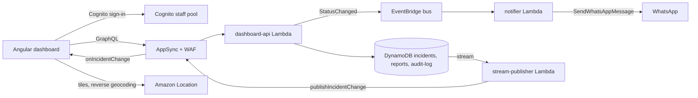

# UrbanBot dashboard

Angular web dashboard for **UrbanBot**, the UrbanBot WhatsApp citizen bot. Agency
operators and municipal supervisors work the incident queue, see incidents on a
real map, and change status; every change reaches the neighbors who joined the
incident on WhatsApp through the existing notifier.

Everything the user reads is in English; the bot's WhatsApp copy is es-MX.

## How it works



- **Sign-in:** Amazon Cognito. The group (`agency`, `official`, `admin`) sets the
  role; `custom:agency_id` scopes agency operators to their incidents. AppSync
  enforces the same rules in `dashboard-api`; the UI only hides what a role cannot do.
- **Data:** `listIncidents` is paginated (limit ≤ 100, opaque `nextToken`). The detail
  (masked neighbors and audit timeline) loads when an incident opens.
- **Real time:** every write to the incidents table, whether from WhatsApp, the
  dashboard or another staff member, reaches open dashboards through the
  `onIncidentChange` subscription. A one-minute refresh covers dropped sockets.
- **Status changes** write the incident and its reports, append the audit log and
  emit one `StatusChanged` event with every joined neighbor's id, the contract the
  notifier already consumes.
- **Map:** MapLibre GL with Amazon Location's Monochrome style (light and dark). It
  opens at the user's location when the browser shares it, otherwise at
  Querétaro. Size of a marker = neighbors joined, color and glyph = status.
- **Legacy statuses** (`OPEN`, `ESCALATED`, Spanish labels) written by the tool
  Lambdas are normalized by `dashboard-api` to the six codes plus `escalated`.

## Demo data

Admins see the demo console. **Load demo data here** writes 30 synthetic reports in
4 incidents around the presenter's current location, with real street names from
Amazon Location. Every row is flagged `synthetic` and **Reset demo data** deletes only
those rows. Real WhatsApp reports appear alongside them.

## Run locally

Requires Node 22+.

```bash
cd apps/dashboard
npm ci
npm start                # http://localhost:4200
npm test -- --watch=false
npm run build            # dist/dashboard/browser
```

`public/config.json` decides the data source:

- `"dataSource": "synthetic"` (default): no backend. Demo accounts, in-browser data
  around your location, OpenStreetMap tiles when `mapsApiKey` is empty.
- `"dataSource": "appsync"`: copy the values the deploy job writes (user pool, client,
  GraphQL URL, maps key). `http://localhost:4200` and `:4300` are allowed referers of
  the maps key.

## Deploy

Only from `main`, through GitLab CI:

1. `terraform:apply` creates or updates `modules/portal`.
2. `dashboard:deploy` reads the Terraform outputs, fetches the Amazon Location key,
   writes `config.json` into the build and uploads it to Amplify Hosting
   (`https://main.<app-id>.amplifyapp.com`).

Staff accounts are declared in `envs/<env>/terraform.tfvars` under `staff_users`.

## Structure

```
src/app/
├── core/        # config, models, rules, gateways (AppSync, synthetic), session, geo, location
├── shared/      # status pill, severity cells, neighbor counter, icons, brand mark, FLIP list
└── features/
    ├── sign-in/     # Cognito sign-in and first-time password
    ├── shell/       # top bar, navigation, phone dock (synthetic mode)
    ├── incidents/   # queue + MapLibre map + detail drawer + status dialog
    └── demo/        # demo console (live seed/reset, synthetic story + phone mirror)
```

## Design and motion

Tokens in `src/styles.css` mirror the UrbanBot design system. Motion appears only
when the city changes: status pill morph, notification ripple on the marker, FLIP
reorder when a neighbor joins, violet sweep on reopen, geohash cell outline and
marker drop for a new report, drawer slide and map fly-to, and the sign-in mark
assembly. All of it respects `prefers-reduced-motion`.

Icons are Tabler (MIT); `scripts/generate-icons.mjs` extracts only the icons used.
